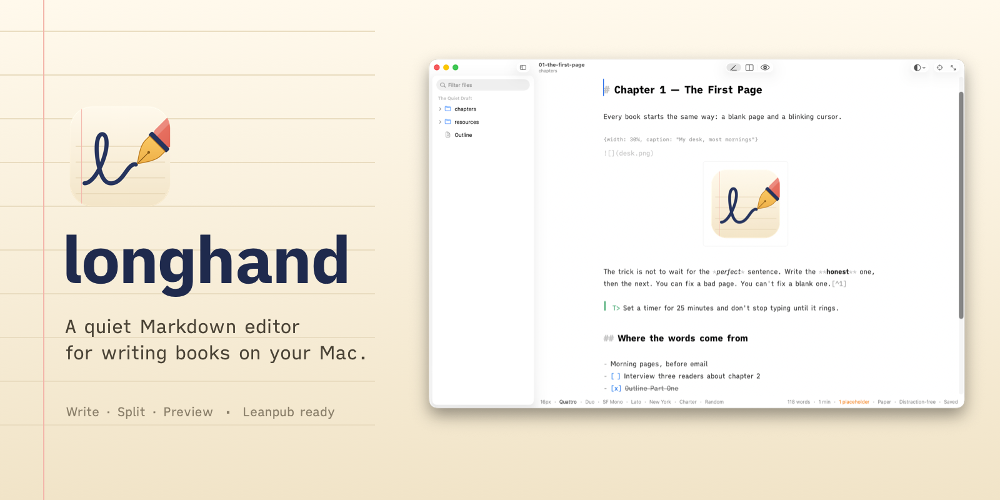
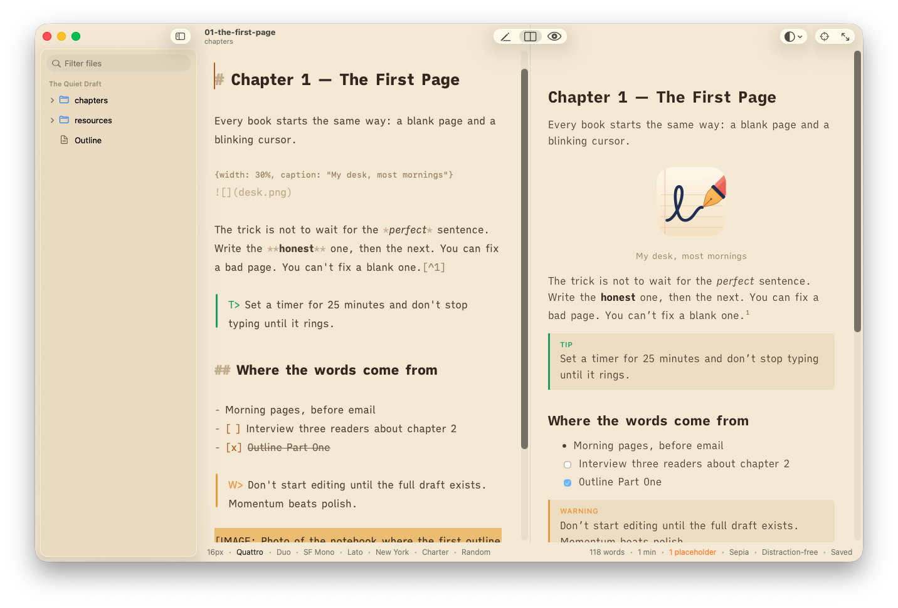
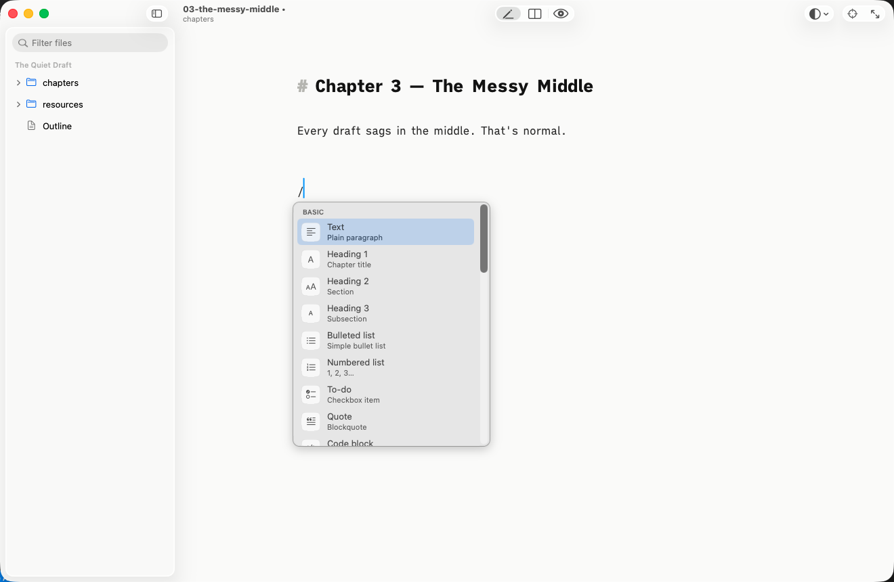
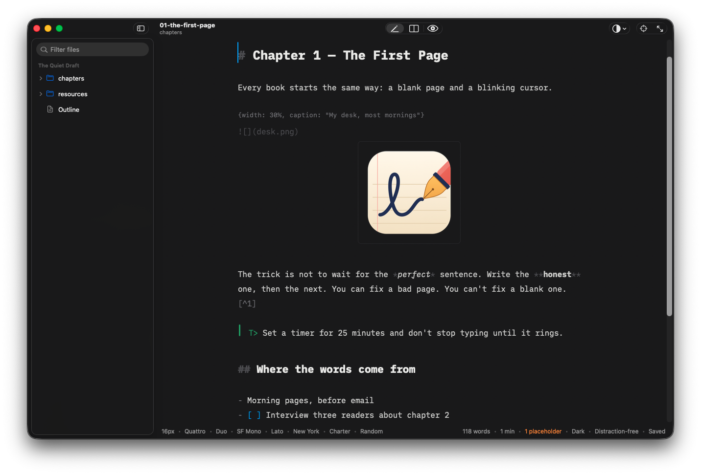

<div align="center"></div>
<h1 align="center">✍️ longhand</h1>
<h4 align="center">A quiet Markdown editor for writing books on your Mac.<br/>Native, tiny, and made for authors, with Leanpub support built in.</h4>
<p align="center"><a href="https://shipkaro.dev/longhand"><b>🌐 shipkaro.dev/longhand</b></a> &nbsp;·&nbsp; <a href="https://github.com/wajahatkarim3/longhand/releases/latest/download/longhand.dmg"><b>⬇️ Download for Mac</b></a></p>
<div align="center"><a href="https://twitter.com/intent/tweet?url=https%3A%2F%2Fgithub.com%2Fwajahatkarim3%2Flonghand&text=longhand%3A%20a%20quiet%2C%20native%20Markdown%20editor%20for%20writing%20books%20on%20the%20Mac.%20Free%20and%20open%20source&hashtags=writing%2Cmarkdown%2Cmacos%2Copensource">
        
    </a> <a href="https://twitter.com/WajahatKarim">
        
    </a>
</div>
<br/>

<div align="center">
    <a href="https://shipkaro.dev/longhand">
        
    </a>
    
    
    
    
    <!-- PRs Welcome -->
    <a href="#-how-to-contribute">
        
    </a>
    <!-- Say Thanks! -->
    <a href="https://saythanks.io/to/wajahatkarim3">
        
    </a>
</div>

<div align="center">
  <sub>Built with ❤︎ by
  <a href="https://twitter.com/WajahatKarim">Wajahat Karim</a> and
  <a href="https://github.com/wajahatkarim3/longhand/graphs/contributors">
    contributors
  </a>
</div>
<br/>
<br/>

Open a folder of chapters and just write. longhand gives you the page, a quiet bar at the bottom,
and nothing else unless you ask for it.

- **Free and open source** (MIT). No account, no subscription, no cloud.
- **Native and light.** SwiftUI + AppKit, opens instantly. No Electron.
- **Your files stay yours.** Plain `.md` files in your own folders. Works next to git, Leanpub and any other editor.
- **Made for books.** Chapters in a sidebar, images on the page, Leanpub/Markua syntax, footnotes, and review notes it helps you track down.

<br/>

## 🤔 Why

I'm writing a book, [RemoteKaro](https://remotekaro.com), as a folder of Markdown chapters. Reviewing
60,000 words meant living in a Markdown editor for weeks, and none of the ones I tried felt right.
Some were cluttered, some couldn't show images, some didn't understand Leanpub, and the calm ones
(iA Writer, Freewrite) aren't built around a folder of chapters.

So I built the editor I wanted: the calm of iA Writer and Freewrite, a sidebar for the whole
manuscript, and the Leanpub bits a book actually needs. longhand is that app, open sourced for every
author writing in Markdown.

<br/>

## ✨ Features

### Three ways to see your writing



- **Write** (⌘1): the page itself. Markdown stays visible but faded, like iA Writer, and images show right on the page.
- **Split** (⌘2): the source on the left, the finished page on the right. They scroll together, line by line.
- **Preview** (⌘3): only the finished page, the way a reader will see it.

### Type `/` for anything



Like Notion: start a line with `/` and pick headings, lists, to-dos, quotes, code, tables, images,
footnotes, Leanpub blurbs (Warning, Tip, Info, Aside…), page breaks and review notes. Keep typing to
filter, press Return to insert.

### Quiet by default

- **The quiet bar.** Text size, fonts, word count and theme as plain words at the bottom. Click to change. It fades away while you type and comes back when you move the mouse.
- **Distraction-free** (⌘⇧D). Hides the sidebar, toolbar and bar and goes fullscreen. Just you and the page.
- **Focus mode** (⌘⇧F) dims everything except the paragraph you're in. **Typewriter** (⌘⇧T) keeps your line centered.

### Themes and fonts



- **Themes:** Light, Paper, Sepia, Dark, or System to follow your Mac.
- **Fonts:** iA Writer Quattro, Duo and Mono (bundled), Lato, New York, Charter, Georgia and SF Mono. Or click **Random** and let it pick.

### Made for books

- **Leanpub / Markua:** `A>` `W>` `T>` `I>` `E>` `Q>` `D>` `X>` blurbs, `{blurb}` and `{aside}` blocks, `{width: 60%, caption: "…"}` figures, `{pagebreak}`, `{sample: true}`, `{#id}` crosslinks and footnotes.
- **Images that just work.** Paths resolve the way Leanpub does (`resources/`, `images/`), or by file name anywhere in your book folder.
- **Review notes.** Leave yourself `[IMAGE: …]`, `[TODO: …]` or `[YOURNAME: check this]`. They're highlighted, counted in the bar, and one click jumps to the next one.
- **Autosave**, live reload when files change on disk (git pulls, other editors), and a welcome note that shows you around.

<br/>

## 💻 Installation

1. Download **[longhand.dmg](https://github.com/wajahatkarim3/longhand/releases/latest/download/longhand.dmg)** (or pick a version from [Releases](https://github.com/wajahatkarim3/longhand/releases)).
2. Open it and drag **longhand** into **Applications**.
3. Launch it. That's it.

More screenshots and the story behind it: **[shipkaro.dev/longhand](https://shipkaro.dev/longhand)**.

longhand is signed with a Developer ID and notarized by Apple, so it opens without any security
warnings. Requires macOS 14 Sonoma or later, on Apple silicon or Intel.

<details>
<summary><b>Build from source</b></summary>
<br/>

You need Xcode 16+ and [XcodeGen](https://github.com/yonaskolb/XcodeGen).

```bash
brew install xcodegen
git clone https://github.com/wajahatkarim3/longhand
cd longhand
xcodegen
open Longhand.xcodeproj        # then press ⌘R
```

To make a signed, notarized DMG yourself (needs a Developer ID certificate and a
`notarytool` keychain profile), see [`scripts/release.sh`](scripts/release.sh).

</details>

<br/>

## ❓ Usage

1. **Open a folder** (⌘O): your book, your notes, anything with Markdown files. Every chapter and image shows up in the sidebar.
2. **Write.** Everything saves automatically.
3. Switch views with ⌘1 / ⌘2 / ⌘3, and use `/` whenever you need a block.

<details>
<summary><b>Keyboard shortcuts</b></summary>
<br/>

| Shortcut | Action |
|---|---|
| ⌘O | Open folder |
| ⌘N | New Markdown file |
| ⌘1 / ⌘2 / ⌘3 | Write / Split / Preview |
| ⌘⇧D | Distraction-free |
| ⌘⇧F | Focus mode |
| ⌘⇧T | Typewriter scrolling |
| ⌘⇧H | Hide Markdown syntax away from the cursor (Typora style) |
| ⌥⌘1 – ⌥⌘4 | Light / Paper / Sepia / Dark theme |
| ⌘+ / ⌘− / ⌘0 | Bigger / smaller / default text |
| ⌘B / ⌘I / ⌘⇧K | Bold / italic / inline code |
| `/` | Insert a block |
| Tab / ⇧Tab | Indent / outdent a list item |

</details>

<br/>

## 📖 Land a Remote Job with RemoteKaro

<a href="https://remotekaro.com"></a>

longhand was built to write this book. [**RemoteKaro**](https://remotekaro.com) is the battle-tested
guide for Pakistani and South Asian developers who want remote jobs that pay in USD: the ATS-proof
resume, LinkedIn, outreach, company validation, interviews and negotiation, all built on 1,237 real
applications. Every chapter is being written and reviewed in longhand.

👉 **[remotekaro.com](https://remotekaro.com)**

<br/>

## 👨 Developed By

<a href="https://twitter.com/WajahatKarim" target="_blank">
  
</a>

**Wajahat Karim**, Google Developer Expert for Android

[](https://twitter.com/WajahatKarim)
[](https://wajahatkarim.com/)
[](https://wajahatkarim.medium.com/)
[](https://www.linkedin.com/in/wajahatkarim/)

<br/>

## 👍 How to Contribute

Bug reports, ideas and PRs are all welcome. The project is generated with XcodeGen, so edit
`project.yml` (not the `.xcodeproj`) when adding files or settings, then run `xcodegen`.

1. Fork it
2. Create your feature branch (git checkout -b my-new-feature)
3. Commit your changes (git commit -am 'Add some feature')
4. Push to the branch (git push origin my-new-feature)
5. Create new Pull Request

<br/>

## 📃 License

    Copyright 2026 Wajahat Karim

    Licensed under the MIT License. See the LICENSE file for details.

The bundled fonts keep their own licenses: iA Writer Quattro, Duo and Mono by
[Information Architects](https://github.com/iaolo/iA-Fonts) and [Lato](https://www.latofonts.com/)
are both under the SIL Open Font License 1.1 (see `Resources/Fonts/`).
